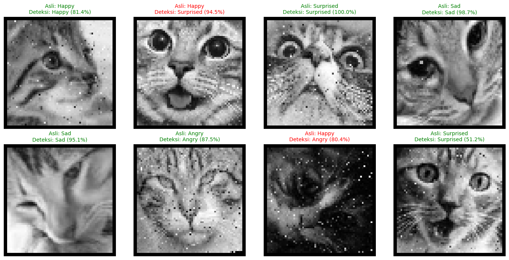
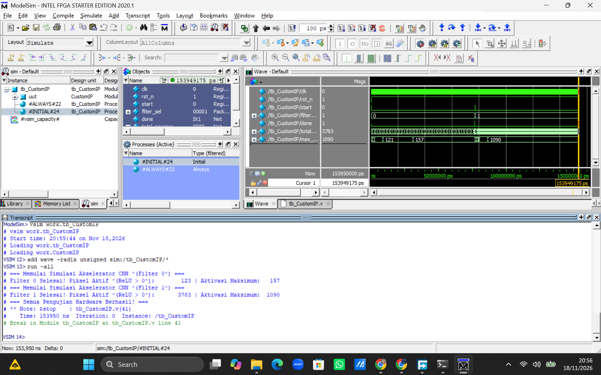
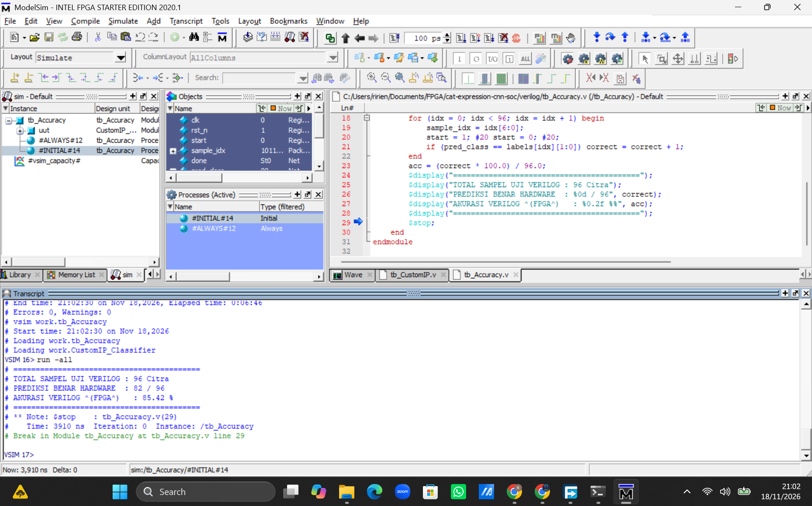

# Laporan Progres 

Dokumen ini merangkum seluruh tahapan implementasi akselerator **Convolutional Neural Network (CNN)** untuk klasifikasi 4 ekspresi wajah kucing (*Angry*, *Happy*, *Sad*, *Surprised*) dari tahap pemrosesan dataset, pelatihan algoritma Python, hingga verifikasi perangkat keras menggunakan Verilog HDL di ModelSim.

---

## 1. Perbandingan Akurasi: Algoritma Python vs Hardware Verilog

| Tahap Implementasi | Presisi Data | Sampel Uji | Jumlah Benar | Akurasi |
| :--- | :--- | :---: | :---: | :---: |
| **Algoritma Software (Python)** | Floating-Point 32-bit (FP32) | 96 Citra | 83 / 96 | **86.46%** |
| **Hardware RTL (Verilog / ModelSim)** | Fixed-Point Quantized 8-bit (INT8) | 96 Citra | 82 / 96 | **85.42%** |

Selisih akurasi antara model perangkat lunak Python dan simulasi perangkat keras Verilog hanya sebesar **1.04%** akibat kuantisasi bobot ke bilangan bulat 8-bit (*int8*).

---

## 2. Tahap 1: Validasi Algoritma CNN (Python)

Citra wajah kucing dipotong otomatis berdasarkan bounding box, diubah ke grayscale 60x60 piksel, lalu ditambahkan 2 piksel *zero-padding* menjadi **64x64 piksel**. Model dilatih pada 864 citra latih dan divalidasi pada 96 citra uji dengan capaian **akurasi testing 86.46%**.

---

## 3. Tahap 2: Simulasi RTL Akselerator Konvolusi 2D + ReLU (ModelSim)

Modul `CustomIP.v` mengeksekusi operasi *Multiply-Accumulate* (MAC) kernel 3x3 dan aktivasi ReLU menggunakan bobot terkuantisasi `cnn_weights.hex` serta citra uji `cat_sample_image.hex`:
- **Filter 0**: Menghasilkan **123 piksel aktif (ReLU > 0)** dengan nilai aktivasi maksimum **157**.
- **Filter 1**: Menghasilkan **3.783 piksel aktif (ReLU > 0)** dengan nilai aktivasi maksimum **1.090**.
- Total waktu komputasi 2 filter pada clock 50 MHz: **153.950 ns** (~0,154 ms).

---

## 4. Tahap 3: Pengujian Akurasi Klasifikasi Hardware (96 Citra Uji)

Modul `CustomIP_Classifier.v` bersama testbench `tb_Accuracy.v` menguji seluruh 96 sampel uji secara langsung pada level RTL di ModelSim dan menghasilkan **82 prediksi tepat dari 96 citra uji** atau **akurasi 85.42%**.

